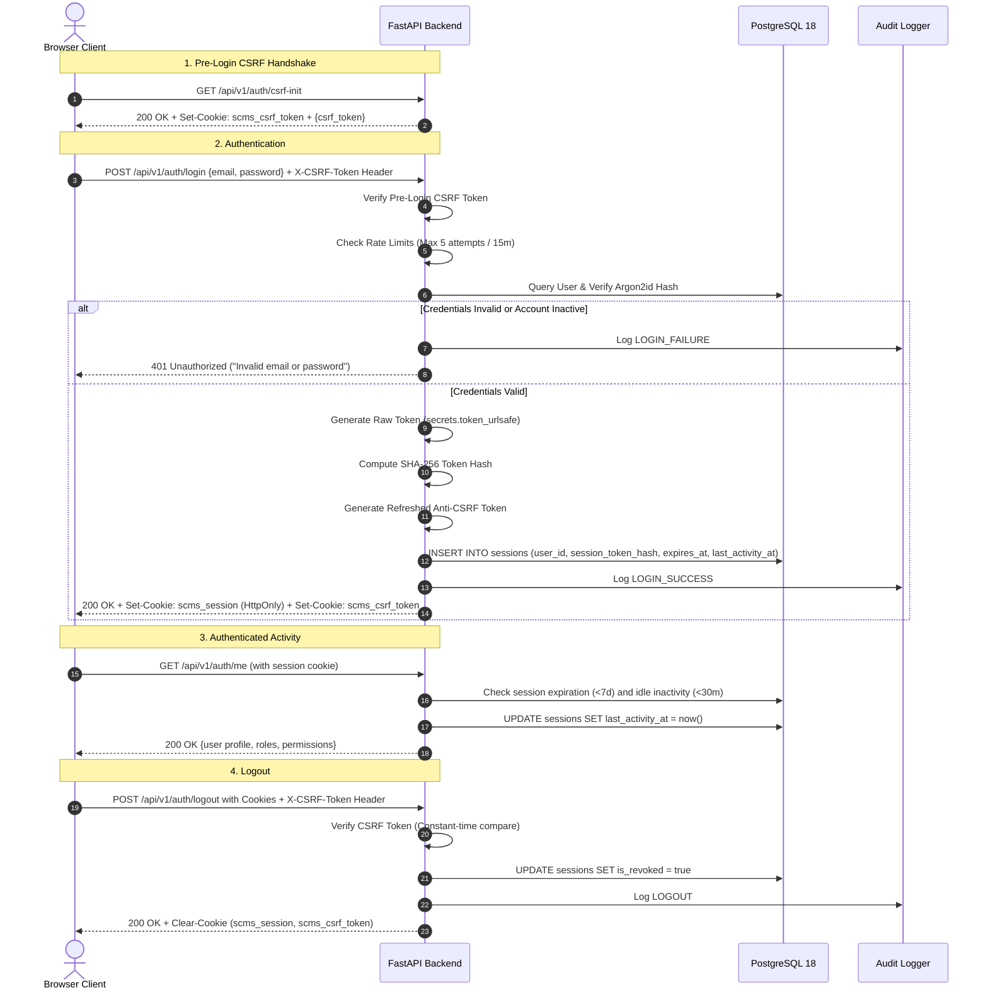

# SCMS Authentication & Security Architecture

> **Document Version:** 1.1.0  
> **Phase:** Phase 2.1 - Security Polish  
> **Author:** Senior Backend Architect (Saran)  
> **Compliance & Standards:** OWASP ASVS 4.0, NIST SP 800-63B  

---

## 1. Architectural Overview

The Sports Club Management System (SCMS) utilizes a **stateful, database-backed session authentication** architecture coupled with **Role-Based Access Control (RBAC)**. 

### Core Tenets
1. **No Client-Side Token Storage:** Authentication tokens are never exposed to browser storage mechanisms (`localStorage`, `sessionStorage`). This eliminates credential harvesting via Cross-Site Scripting (XSS).
2. **Stateful Database Validation:** Every request validates session state against PostgreSQL. Terminated or compromised sessions can be revoked immediately across all devices.
3. **No JWT-Only Reliance:** Avoids stateless JWT vulnerabilities (inability to revoke tokens immediately without distributed blacklists).
4. **Dual Inactivity & Absolute Timeout:** Automatically purges abandoned sessions after 30 minutes of inactivity while enforcing a hard 7-day maximum TTL.
5. **Full CSRF Protection Lifecycle:** Protects against both Login-CSRF and post-authentication state tampering via Double-Submit tokens.
6. **Defense in Depth:** Combines Argon2id password hashing, sliding-window rate limiting, anti-CSRF token verification, and granular permission dependencies.

---

## 2. Password Hashing (Argon2id)

Passwords are hashed using **Argon2id** via `argon2-cffi`. Argon2id provides superior resistance against both GPU-accelerated brute force and side-channel attacks.

### Configuration Parameters:
- **Variant:** Argon2id (`Type.ID`)
- **Memory Cost:** 65,536 KiB (64 MiB)
- **Time Cost:** 2 iterations
- **Parallelism:** 1 thread
- **Hash Length:** 32 bytes

```
Stored Format: $argon2id$v=19$m=65536,t=2,p=1$<salt>$<hash>
```

---

## 3. Session Lifecycle & Token Management



### Dual Session Expiration:
1. **Idle Inactivity Timeout:** Configured via `SESSION_IDLE_TIMEOUT_SECONDS` (default: 1,800 seconds / 30 minutes). If no request occurs within 30 minutes, the session is invalidated (`"Session timed out due to inactivity. Please log in again."`).
2. **Absolute TTL:** Configured via `SESSION_EXPIRE_SECONDS` (default: 604,800 seconds / 7 days). Regardless of activity, sessions expire after 7 days (`"Session has expired. Please log in again."`).

---

## 4. Browser vs. Tooling Authentication Policy

> [!IMPORTANT]
> - **Browser Clients:** MUST rely exclusively on HTTP-only cookies (`scms_session`). Browser JavaScript MUST NOT extract, store, or transmit session tokens in `localStorage` or `sessionStorage`.
> - **CLI / Integration Tooling Fallback:** Authorized headless tools and automated scripts may authenticate using `Authorization: Bearer <session_token>`.

---

## 5. Cookie Security Policy

Cookies are issued with strict flags:

| Attribute | Setting | Rationale |
|---|---|---|
| `HttpOnly` | `True` (for `scms_session`) | Prevents document scripts from accessing the session token. Mitigates XSS token exfiltration. |
| `SameSite` | `Lax` (configurable) | Restricts cookies from being sent on cross-site requests, mitigating cross-site request forgery. |
| `Secure` | Configurable (`False` in dev, `True` in prod) | Restricts transmission to HTTPS only in production environments. |
| `Path` | `/` | Confines cookie scope to the SCMS backend API domain. |

---

## 6. Cross-Site Request Forgery (CSRF) Protection

SCMS implements the **Double-Submit Anti-CSRF Pattern** across both login and post-login mutations:

1. **Pre-Login Handshake (`GET /api/v1/auth/csrf-init`):**
   - Public endpoint that issues `scms_csrf_token` cookie and returns token in JSON response.
   - Frontend reads this token on initial page load.
2. **Login Protection (`POST /api/v1/auth/login`):**
   - Protected by `require_login_csrf`. The client must attach the matching `X-CSRF-Token` header.
   - Mitigates Login-CSRF attacks where an attacker forces a victim to sign into an attacker's account.
3. **Authenticated State-Changing Operations (`POST /api/v1/auth/logout`, etc.):**
   - Protected by `require_csrf`. Rejects any cookie-authenticated mutating request if `X-CSRF-Token` is missing or does not match `scms_csrf_token` via constant-time comparison (`secrets.compare_digest`).

---

## 7. Rate Limiting & Anti-Enumeration

### Sliding Window Rate Limiter:
- Keyed on client IP and target email (`f"{ip}:{email}"`).
- Limits failed login attempts to **5 attempts per 15-minute sliding window**.
- Upon reaching threshold, the client is blocked with `429 Too Many Requests` and a `Retry-After: 900` header.
- Successful login clears the failure count.

### Anti-Enumeration:
- Login errors return an identical generic response:
  ```json
  {"detail": "Invalid email or password"}
  ```
- No user-facing distinction between non-existent accounts, invalid passwords, or inactive user accounts.

---

## 8. Role-Based Access Control (RBAC)

Authorization is **capability/permission-based** rather than hardcoded role names.

### Relational Hierarchy:
```
users (1:M) -> user_roles (M:1) -> roles (1:M) -> role_permissions (M:1) -> permissions
```

### Initial Roles & Core Capabilities:
- **`Member`**: Basic court availability viewing and court booking privileges (`court:view`, `court:book`, `shop:view`, `cafe:view`).
- **`Staff`**: Front desk operations, check-ins, booking management, and POS orders (`court:manage`, `member:view`, `shop:manage`, `cafe:manage`).
- **`Manager`**: Operational oversight, member subscription management, expense tracking, and audit logging (`member:manage`, `finance:view`, `finance:manage`, `audit:view`).
- **`Admin`**: Full system administration and privilege control (`admin:access`).

### Enforcement:
- `require_permission(permission_code: str)`: FastAPI dependency factory that dynamically queries the database for active user permissions.
- The `Admin` role automatically satisfies all permission checks.
- Unauthorized attempts trigger a `PERMISSION_DENIED` event in the audit log and return `403 Forbidden`.

---

## 9. CORS Policy for Frontend Development

Allowed development origins configured in `backend/app/core/config.py`:
- `http://localhost:3000`
- `http://localhost:5173` (Standard Vite port)
- `http://localhost:5174` (Secondary Vite fallback port)
- `http://127.0.0.1:3000`
- `http://127.0.0.1:5173`
- `http://127.0.0.1:5174`

`allow_credentials=True` is strictly enabled only for these explicitly listed origins. No wildcard origins are used.
