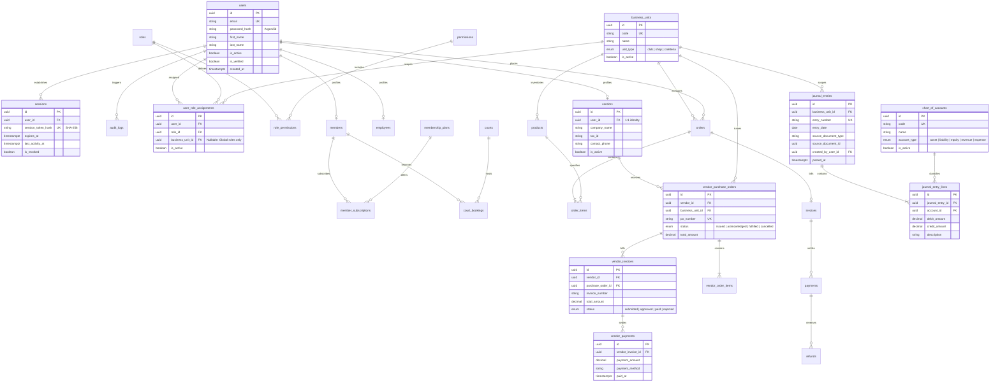

# SCMS Database Architecture & Relational Design

> **Version:** 2.1.0  
> **Status:** Architecture Approved with Phase 2.2A Corrections Incorporated  
> **Date:** November 2026  
> **Engine:** PostgreSQL 18 (Self-Hosted via Docker Compose)  
> **ORM:** SQLAlchemy 2.x | **Migrations:** Alembic  
> **Companion Documents:**
> - [Phase 2.2A Architecture Review](file:///c:/Users/Saranjeet%20Singh/OneDrive/Desktop/APEX_Club/docs/phase2_2a_architecture_review.md)
> - [Platform Architecture v2.1.0](file:///c:/Users/Saranjeet%20Singh/OneDrive/Desktop/APEX_Club/docs/platform-architecture.md)
> - [Role-Permission Matrix v2.1.0](file:///c:/Users/Saranjeet%20Singh/OneDrive/Desktop/APEX_Club/docs/role-permission-matrix.md)
> - [Dashboard Specifications v2.1.0](file:///c:/Users/Saranjeet%20Singh/OneDrive/Desktop/APEX_Club/docs/dashboard-specifications.md)
> - [API Contracts v2.1.0](file:///c:/Users/Saranjeet%20Singh/OneDrive/Desktop/APEX_Club/docs/api-contracts.md)

---

## 1. Relational Entity-Relationship Diagram (ERD)



---

## 2. Table Implementation Status

| Table Name | Schema Domain | Status | Notes |
|---|---|---|---|
| `users` | Identity & Authentication | **Live / Verified** | Argon2id password hash, UUID PK. |
| `roles` | Authorization & RBAC | **Live / Verified** | Standardizing to 8 platform roles in Phase 3. |
| `permissions` | Authorization & RBAC | **Live / Verified** | Atomic capability strings. |
| `user_roles` | Authorization & RBAC | **Live / Deprecating** | To be migrated to `user_role_assignments`. |
| `role_permissions` | Authorization & RBAC | **Live / Verified** | Maps roles to permissions. |
| `sessions` | Authentication & Security | **Live / Verified** | Stores SHA-256 session token hashes, 30m idle, 7d TTL. |
| `audit_logs` | Security & Governance | **Live / Verified** | Immutable administrative log. |
| `business_units` | Organization & Scoping | *Phase 3 Proposed* | Commercial entities (Club, Shops, Cafeterias). |
| `user_role_assignments` | Organization & Scoping | *Phase 3 Proposed* | Replaces `user_roles` with explicit scoping. |
| `migration_quarantine_user_roles` | Migration & Safety | *Phase 3 Proposed* | Staging for ambiguous legacy role mappings. |
| `members` | Member Domain | *Phase 3 Proposed* | 1:1 user profile, emergency contact, barcode ID. |
| `membership_plans` | Member Domain | *Phase 3 Proposed* | Gold, Silver, Junior tier definitions. |
| `member_subscriptions` | Member Domain | *Phase 3 Proposed* | Plan subscription periods and renewal dates. |
| `employees` | Staff Operations | *Phase 3 Proposed* | 1:1 user profile, job title, department, hourly rate. |
| `employee_shifts` | Staff Operations | *Phase 3 Proposed* | Roster shifts, clock-in, clock-out, break tracking. |
| `vendors` | Vendor Procurement | *Phase 3 Proposed* | 1:1 supplier profile linked to `users.id`. |
| `courts` | Athletics & Facilities | *Phase 3 Proposed* | Tennis and cricket playing facilities. |
| `court_bookings` | Athletics & Facilities | *Phase 3 Proposed* | Reservation slots, guest counts, light tokens. |
| `products` | Commercial Inventory | *Phase 3 Proposed* | Unit-scoped retail gear & F&B items. |
| `orders` | Commercial Point of Sale | *Phase 3 Proposed* | Customer orders in shop/cafeteria/club. |
| `order_items` | Commercial Point of Sale | *Phase 3 Proposed* | Line items with unit price and cost price. |
| `invoices` | Customer Billing | *Phase 3 Proposed* | Accounts Receivable customer billing document. |
| `payments` | Customer Billing | *Phase 3 Proposed* | Customer settlements (Cash, Card, Member Tab). |
| `refunds` | Customer Billing | *Phase 3 Proposed* | Reversal records referencing original payment. |
| `vendor_purchase_orders` | Accounts Payable (AP) | *Phase 3 Proposed* | Inbound supplier orders issued by units. |
| `vendor_order_items` | Accounts Payable (AP) | *Phase 3 Proposed* | Equipment/food supplier line items. |
| `vendor_invoices` | Accounts Payable (AP) | *Phase 3 Proposed* | Supplier payment requests submitted via portal. |
| `vendor_payments` | Accounts Payable (AP) | *Phase 3 Proposed* | Supplier AP disbursements. |
| `chart_of_accounts` | General Ledger (GL) | *Phase 3 Proposed* | Standard chart of accounts (Assets, Liabilities, etc.). |
| `journal_entries` | General Ledger (GL) | *Phase 3 Proposed* | Balanced double-entry transaction headers. |
| `journal_entry_lines` | General Ledger (GL) | *Phase 3 Proposed* | Debit and credit lines classifying economic events. |

---

## 3. General Ledger & Double-Entry Schema Design

### 3.1 `chart_of_accounts`
Defines the financial accounts for revenue, costs, assets, and liabilities across the enterprise.

```sql
CREATE TYPE account_type_enum AS ENUM (
    'asset',
    'liability',
    'equity',
    'revenue',
    'expense'
);

CREATE TABLE chart_of_accounts (
    id UUID PRIMARY KEY DEFAULT gen_random_uuid(),
    code VARCHAR(32) NOT NULL UNIQUE,
    name VARCHAR(128) NOT NULL,
    account_type account_type_enum NOT NULL,
    description TEXT,
    is_active BOOLEAN NOT NULL DEFAULT TRUE,
    created_at TIMESTAMPTZ NOT NULL DEFAULT CURRENT_TIMESTAMP
);

CREATE INDEX idx_coa_type ON chart_of_accounts (account_type);
```

### 3.2 `journal_entries`
Header record for every balanced financial transaction.

```sql
CREATE TABLE journal_entries (
    id UUID PRIMARY KEY DEFAULT gen_random_uuid(),
    business_unit_id UUID NOT NULL REFERENCES business_units(id) ON DELETE RESTRICT,
    entry_number VARCHAR(64) NOT NULL UNIQUE,
    entry_date DATE NOT NULL,
    source_document_type VARCHAR(64) NOT NULL, -- 'order', 'invoice', 'vendor_invoice', 'refund', 'payroll'
    source_document_id UUID,
    memo TEXT,
    created_by_user_id UUID NOT NULL REFERENCES users(id) ON DELETE RESTRICT,
    posted_at TIMESTAMPTZ NOT NULL DEFAULT CURRENT_TIMESTAMP
);

CREATE INDEX idx_je_unit_date ON journal_entries (business_unit_id, entry_date);
CREATE INDEX idx_je_source ON journal_entries (source_document_type, source_document_id);
```

### 3.3 `journal_entry_lines`
Debit and credit line items enforcing $\sum \text{debits} == \sum \text{credits}$.

```sql
CREATE TABLE journal_entry_lines (
    id UUID PRIMARY KEY DEFAULT gen_random_uuid(),
    journal_entry_id UUID NOT NULL REFERENCES journal_entries(id) ON DELETE CASCADE,
    account_id UUID NOT NULL REFERENCES chart_of_accounts(id) ON DELETE RESTRICT,
    debit_amount NUMERIC(12, 2) NOT NULL DEFAULT 0.00 CHECK (debit_amount >= 0.00),
    credit_amount NUMERIC(12, 2) NOT NULL DEFAULT 0.00 CHECK (credit_amount >= 0.00),
    description VARCHAR(255),
    CONSTRAINT chk_debit_or_credit CHECK (
        (debit_amount > 0 AND credit_amount = 0) OR
        (credit_amount > 0 AND debit_amount = 0)
    )
);

CREATE INDEX idx_jel_entry ON journal_entry_lines (journal_entry_id);
CREATE INDEX idx_jel_account ON journal_entry_lines (account_id);
```

---

## 4. Migration Strategy: `user_roles` to `user_role_assignments`

### 4.1 Transition Rules & Invariants
1. `user_role_assignments` schema:
   ```sql
   CREATE TABLE user_role_assignments (
       id UUID PRIMARY KEY DEFAULT gen_random_uuid(),
       user_id UUID NOT NULL REFERENCES users(id) ON DELETE CASCADE,
       role_id INTEGER NOT NULL REFERENCES roles(id) ON DELETE RESTRICT,
       business_unit_id UUID REFERENCES business_units(id) ON DELETE CASCADE,
       is_active BOOLEAN NOT NULL DEFAULT TRUE,
       assigned_at TIMESTAMPTZ NOT NULL DEFAULT CURRENT_TIMESTAMP,
       assigned_by_user_id UUID REFERENCES users(id) ON DELETE SET NULL,
       CONSTRAINT uq_user_role_unit UNIQUE NULLS NOT DISTINCT (user_id, role_id, business_unit_id)
   );
   ```
2. **Explicit Assignment Rules:**
   - `System Admin` & `Club Owner`: `business_unit_id = NULL` (Global scope).
   - `Member` & `Employee`: `business_unit_id = <MAIN_SPORTS_CLUB_ID>`.
   - `Sports Shop Owner`: `business_unit_id` must reference a unit of type `shop`.
   - `Cafeteria Manager`: `business_unit_id` must reference a unit of type `cafeteria`.
3. **Quarantine Table for Unresolved Mappings:**
   ```sql
   CREATE TABLE migration_quarantine_user_roles (
       id SERIAL PRIMARY KEY,
       user_id UUID NOT NULL,
       role_id INTEGER NOT NULL,
       reason TEXT NOT NULL,
       created_at TIMESTAMPTZ NOT NULL DEFAULT CURRENT_TIMESTAMP
   );
   ```
4. **Data-Integrity Validation Assertion:**
   ```sql
   -- Verification rule executed before committing migration:
   DO $$
   DECLARE
       invalid_count INTEGER;
   BEGIN
       SELECT COUNT(*) INTO invalid_count
       FROM user_role_assignments ura
       JOIN roles r ON ura.role_id = r.id
       WHERE ura.business_unit_id IS NULL AND r.name NOT IN ('System Admin', 'Club Owner');
       
       IF invalid_count > 0 THEN
           RAISE EXCEPTION 'Migration Invariant Violation: % non-global role assignments have NULL business_unit_id.', invalid_count;
       END IF;
   END $$;
   ```
