# SCMS — Phase 2.2A: Architecture Review & Correction Document

> **Document Version:** 1.0.0  
> **Status:** Architecture Approved with Corrections Incorporated (Documentation Only)  
> **Date:** November 2026  
> **Authors:** Principal Software Architect & Senior PostgreSQL Security Architect  
> **Companion Documents:**
> - [Platform Architecture v2.1.0](file:///c:/Users/Saranjeet%20Singh/OneDrive/Desktop/APEX_Club/docs/platform-architecture.md)
> - [Database Design v2.1.0](file:///c:/Users/Saranjeet%20Singh/OneDrive/Desktop/APEX_Club/docs/database-design.md)
> - [Role-Permission Matrix v2.1.0](file:///c:/Users/Saranjeet%20Singh/OneDrive/Desktop/APEX_Club/docs/role-permission-matrix.md)
> - [Dashboard Specifications v2.1.0](file:///c:/Users/Saranjeet%20Singh/OneDrive/Desktop/APEX_Club/docs/dashboard-specifications.md)
> - [API Contracts v2.1.0](file:///c:/Users/Saranjeet%20Singh/OneDrive/Desktop/APEX_Club/docs/api-contracts.md)

---

## 1. Executive Summary & Purpose

Following executive review of the Phase 2.2 platform architecture proposal, this document codifies the necessary architectural corrections and enhancements before proceeding to Phase 3 database migrations and code implementation.

This review addresses six primary architectural areas:
1. **Explicit Role Migration Semantics:** Eradicating dangerous default `NULL` assumptions and defining strict scoping rules for legacy data migration.
2. **Permission-Bounded Global Authorization:** Eliminating blanket global role bypasses in favor of strict, permission-bounded cross-unit authorization.
3. **Server-Resolved Vendor Ownership:** Enforcing identity-derived vendor isolation that never trusts client-supplied identifiers.
4. **GAAP/IFRS Double-Entry Financial Foundation:** Replacing high-level cash arithmetic with a double-entry general ledger (`chart_of_accounts`, `journal_entries`, `journal_entry_lines`) supporting revenue recognition, COGS, liabilities, and audit trails.
5. **Precise Authentication Terminology:** Accurately describing the cryptographic separation between Argon2id (passwords) and SHA-256 (session tokens).
6. **Standardized Role Catalog:** Reconciling the 8 standard roles (`System Admin`, `Club Owner`, `Club Manager`, `Employee`, `Member`, `Sports Shop Owner`, `Cafeteria Manager`, `Vendor`) and providing deterministic legacy mapping.

---

## 2. Detailed Architectural Corrections

### Correction 1: Explicit Role Migration Semantics & Quarantine Workflow

#### The Flaw in the Initial Proposal
The initial Phase 2.2 proposal migrated existing `user_roles` records directly into `user_role_assignments` with `business_unit_id = NULL`. In a multi-unit scoping system, treating `NULL` as an implicit global pass would accidentally elevate existing `Member` or `Staff` accounts to club-wide and cross-unit administrative authority.

#### The Corrected Migration Semantics
1. **Global Assignments (`business_unit_id IS NULL`):** Permitted **only** for roles explicitly classified as Global in the system catalog:
   - `System Admin`
   - `Club Owner`
2. **Mandatory Scoping to Main Sports Club:**
   - Existing `Member` assignments are migrated with `business_unit_id = <ID_OF_MAIN_SPORTS_CLUB>`.
   - Existing `Staff` assignments are migrated to `Employee` with `business_unit_id = <ID_OF_MAIN_SPORTS_CLUB>`.
   - `Club Manager` assignments are scoped to `business_unit_id = <ID_OF_MAIN_SPORTS_CLUB>`.
3. **Mandatory Commercial Scoping (`business_unit_id IS NOT NULL`):**
   - `Sports Shop Owner` assignments **must** link to a unit where `unit_type = 'shop'`. A shop owner cannot be assigned with `business_unit_id = NULL` or to a cafeteria unit.
   - `Cafeteria Manager` assignments **must** link to a unit where `unit_type = 'cafeteria'`.
4. **Vendor Scoping:**
   - `Vendor` users are **not** assigned to internal business units. Instead, their authorization is rooted in a 1:1 linked record in `vendors` where `vendors.user_id = users.id`.
5. **Quarantine & Safety Invariants:**
   - Any legacy assignment that does not satisfy these invariants is **not** assigned global access.
   - The migration inserts ambiguous records into a temporary `migration_quarantine_user_roles` table, marks `is_active = FALSE`, and logs a critical audit warning requiring manual administrator resolution.
6. **Rollback & Data-Integrity Verification:**
   - Migration runs inside an atomic PostgreSQL transaction block.
   - Verification query asserts:
     ```sql
     SELECT COUNT(*) FROM user_role_assignments ura
     JOIN roles r ON ura.role_id = r.id
     WHERE ura.business_unit_id IS NULL AND r.name NOT IN ('System Admin', 'Club Owner');
     -- Must return exactly 0. If > 0, transaction is aborted.
     ```

---

### Correction 2: Permission-Bounded Global Authorization (No Blanket Bypass)

#### The Flaw in the Initial Proposal
The previous design suggested that Global roles (such as `System Admin` or `Club Owner`) might bypass permission checks entirely when navigating across units.

#### The Corrected Authorization Architecture
1. **No Blanket Bypasses:** Neither `System Admin` nor `Club Owner` has a wildcard `*` bypass at the database or API level. Every single private API endpoint demands an explicit, atomic permission string (e.g., `inventory:view`, `financials:audit`, `user:create`).
2. **Explicit Scope Hierarchy:**
   - **Global Scope (`G`):** The user possesses a role assignment with `business_unit_id IS NULL` for a role that has been explicitly granted that atomic permission in `role_permissions`. The backend allows querying across all units.
   - **Business-Unit Scope (`U`):** The user possesses a role assignment where `business_unit_id == requested_unit_id` for a role granted that atomic permission. Requests targeting any other unit are rejected with `403 Forbidden`.
   - **Self Scope (`S`):** Constrained to records where `user_id == current_user.id` or `vendor_id == current_user.vendor_id` (e.g., member viewing own bookings, employee viewing own shifts, vendor viewing own purchase orders).
3. **Sensitive Administrative Operations:**
   - Certain permissions are strictly reserved for `System Admin` (e.g., `system:config`, `audit:view_all`, `security:manage_roles`).
   - Executive financial approvals and pricing model adjustments are reserved for `Club Owner`.
4. **Mandatory Cross-Unit Audit Trail:**
   - Any read or mutation executed by a Global role (`System Admin` or `Club Owner`) inside a specific commercial unit (Shop or Cafeteria) automatically logs an immutable audit entry in `audit_logs` capturing: `user_id`, `active_role`, `target_business_unit_id`, `endpoint`, `timestamp`, and `client_ip`.

---

### Correction 3: Server-Side Identity-Derived Vendor Isolation

#### The Flaw in the Initial Proposal
Previous API draft examples allowed client requests to specify `vendor_id` in URL parameters or request bodies, which could introduce Insecure Direct Object Reference (IDOR) vulnerabilities if client-supplied IDs were trusted.

#### The Corrected Isolation Architecture
1. **Relational Identity Chain:**
   $$\text{users} \xrightarrow{1:1} \text{vendors} \xrightarrow{1:N} \text{vendor\_purchase\_orders} \xrightarrow{1:N} \text{vendor\_invoices} \xrightarrow{1:N} \text{vendor\_payments}$$
2. **Zero Trust in Client-Supplied IDs:**
   - All vendor portal endpoints (`/api/v1/vendor/...`) completely disallow `vendor_id` in request payloads, query strings, or path parameters.
   - The backend dependency `get_current_active_vendor` executes:
     ```python
     vendor = db.query(Vendor).filter(Vendor.user_id == current_user.id, Vendor.is_active.is_(True)).first()
     if not vendor:
         raise HTTPException(status_code=403, detail="User account is not linked to an active vendor profile.")
     ```
   - All database queries for purchase orders and invoices are strictly parameterized with this server-resolved `vendor.id`.
3. **Targeted Verification Tests Required in Phase 3:**
   - **Test 3.1 (Self Access):** Authenticated Vendor A requests `/api/v1/vendor/purchase-orders` $\rightarrow$ Returns only POs matching Vendor A's profile.
   - **Test 3.2 (Cross-Vendor IDOR Defense):** Vendor A attempts `GET /api/v1/vendor/purchase-orders/{po_id_of_vendor_b}` $\rightarrow$ Returns `404 Not Found` (or `403 Forbidden`) and writes a security violation event to `audit_logs`.
   - **Test 3.3 (Customer Sales Isolation):** Vendor A attempts `GET /api/v1/business-units/{shop_id}/orders` or `/invoices` $\rightarrow$ Returns `403 Forbidden`.
   - **Test 3.4 (Commercial Report Isolation):** Vendor A attempts `GET /api/v1/reports/business-unit/{shop_id}/summary` $\rightarrow$ Returns `403 Forbidden`.

---

### Correction 4: GAAP/IFRS Double-Entry Financial Architecture

#### The Flaw in the Initial Proposal
The previous report utilized a simplistic equation:
$$\text{Net Operating Surplus} = \text{Gross Revenue} - \text{Vendor AP Disbursements}$$
This formula conflated cash flow with net income, ignored Cost of Goods Sold (COGS), treated capital equipment purchases identically to operating expenses, and provided no balance sheet integrity.

#### The Corrected Double-Entry Ledger Schema
SCMS implements an industry-standard double-entry bookkeeping engine comprising three core entities:
1. `chart_of_accounts`:
   - Account types: `Asset`, `Liability`, `Equity`, `Revenue`, `Expense`.
   - Examples:
     - `1010` - Cash & Bank (Asset)
     - `1200` - Accounts Receivable (Asset)
     - `1300` - Retail Merchandise Inventory (Asset)
     - `1310` - Food & Beverage Inventory (Asset)
     - `2010` - Accounts Payable (Liability)
     - `4010` - Membership Subscription Revenue (Revenue)
     - `4020` - Court Booking Fees (Revenue)
     - `4030` - Sports Equipment Sales Revenue (Revenue)
     - `4040` - Food & Beverage Dining Revenue (Revenue)
     - `4090` - Sales Discounts & Allowances (Contra-Revenue)
     - `4095` - Customer Returns & Refunds (Contra-Revenue)
     - `5010` - Cost of Goods Sold - Sports Equipment (Expense)
     - `5020` - Cost of Goods Sold - Food & Beverage (Expense)
     - `6010` - Facility Maintenance & Utilities (Expense)
     - `6020` - Staff Payroll Expense (Expense)
2. `journal_entries`:
   - Header table containing `entry_number`, `entry_date`, `business_unit_id`, `source_document_type` (`order`, `invoice`, `vendor_invoice`, `refund`, `manual`), `source_document_id`, `posted_at`, and `created_by_user_id`.
3. `journal_entry_lines`:
   - Line items containing `account_id`, `debit_amount`, `credit_amount`, `description`.
   - **Integrity Invariant:** For every `journal_entry_id`, $\sum \text{debits} == \sum \text{credits}$. Enforced via database triggers/deferred constraints.

#### Clear Distinction of Financial Cycles
- **Cycle 1: Inventory Procurement (Balance Sheet Event — Zero Impact on P&L):**
  - Event: Vendor delivers \$5,000 of tennis racquets; vendor invoice approved.
  - Entry:
    - `Debit 1300 (Merchandise Inventory)`: \$5,000 [Asset increases]
    - `Credit 2010 (Accounts Payable)`: \$5,000 [Liability increases]
  - *Result:* No expense recorded at this time.
- **Cycle 2: Inventory Consumption / Sale (Revenue & COGS Recognized):**
  - Event: Member buys racquet for \$250 cash (cost basis \$150).
  - Entry A (Revenue recognition):
    - `Debit 1010 (Cash)`: \$250 [Asset increases]
    - `Credit 4030 (Equipment Sales Revenue)`: \$250 [Revenue increases]
  - Entry B (Matching COGS):
    - `Debit 5010 (COGS - Equipment)`: \$150 [Expense increases]
    - `Credit 1300 (Merchandise Inventory)`: \$150 [Asset decreases]
  - *Result:* Gross Profit of \$100 properly recognized.
- **Cycle 3: Supplier Payment Disbursement (Cash Flow Event — Zero Impact on P&L):**
  - Event: Club pays \$5,000 vendor invoice via bank wire.
  - Entry:
    - `Debit 2010 (Accounts Payable)`: \$5,000 [Liability decreases]
    - `Credit 1010 (Cash)`: \$5,000 [Asset decreases]
  - *Result:* Liquidity changes; net operating surplus is unaffected.
- **Cycle 4: Customer Refund (Contra-Revenue):**
  - Event: Member returns defective racquet (\$250 refunded).
  - Entry:
    - `Debit 4095 (Customer Returns & Refunds)`: \$250 [Contra-Revenue increases]
    - `Credit 1010 (Cash)`: \$250 [Asset decreases]
    - `Debit 1300 (Merchandise Inventory)`: \$150 [Asset restored]
    - `Credit 5010 (COGS - Equipment)`: \$150 [Expense reversed]

#### Correct Financial Definitions for the Executive Dashboard
$$\text{Gross Sales} = \sum \text{Invoiced Customer Charges}$$
$$\text{Net Sales} = \text{Gross Sales} - \text{Discounts} - \text{Refunds}$$
$$\text{Gross Profit} = \text{Net Sales} - \text{Cost of Goods Sold (COGS)}$$
$$\text{Operating Profit} = \text{Gross Profit} - \text{Operating Expenses (OpEx: Staff, Utilities, Maintenance)}$$
$$\text{Free Cash Flow} = \text{Operating Cash Inflows} - \text{Supplier Disbursements} - \text{Capital Expenditures}$$

---

### Correction 5: Accurate Authentication & Cryptographic Terminology

The architecture documentation has been thoroughly corrected to accurately reflect the cryptographic mechanisms implemented in Phase 2 and Phase 2.1:
1. **Password Hashing:** **Argon2id** (`argon2-cffi`) with secure parameters ($m=65536, t=3, p=4$) is used exclusively for one-way password hashing upon user registration and password updates, and verified during login.
2. **Session Token Generation & Storage:**
   - High-entropy cryptographic random session tokens (32 bytes, 256 bits) generated via `secrets.token_urlsafe(32)`.
   - The plaintext token is **never** stored in the database.
   - The database stores only the **SHA-256** cryptographic hash of the session token (`sessions.session_token_hash`).
   - Session lookup hashes incoming cookie tokens via SHA-256 and performs an indexed lookup against `session_token_hash`.
3. **Session Transport:**
   - Transmitted to the browser via an **HTTP-only, SameSite=Lax** cookie (`scms_session`). Secure flag is enabled in staging/production environments.
   - JavaScript is strictly prohibited from accessing session tokens.
4. **Anti-CSRF Protection:**
   - Double-submit cookie pattern initialized via `GET /api/v1/auth/csrf-init`.
   - Validated on state-changing requests using constant-time string comparison (`hmac.compare_digest`) between the `scms_csrf_token` cookie and the `X-CSRF-Token` HTTP header.
5. **Authorization:**
   - Role-Based Access Control (RBAC) maps users to atomic permissions.
   - Business Unit Scope maps assignments to specific operational domains.

---

### Correction 6: Standardized 8-Role Catalog & Legacy Role Reconciliation

The system canonical role catalog is standardized to the following eight roles:

```mermaid
classDiagram
    class SystemAdmin {
        +Global technical oversight
        +User & role provisioning
        +Audit log explorer
    }
    class ClubOwner {
        +Executive oversight
        +Consolidated P&L
        +Strategic pricing & governance
    }
    class ClubManager {
        +Main Club operations
        +Court scheduling & maintenance
        +Staff roster management
    }
    class Employee {
        +Front-desk check-in
        +Court marshaling & coaching
        +Shift & task logging
    }
    class Member {
        +Court booking & check-in
        +Membership tier perks
        +Retail & cafe purchasing
    }
    class SportsShopOwner {
        +Retail inventory & pricing
        +POS checkout
        +Shop supplier POs
    }
    class CafeteriaManager {
        +F&B menu & pricing
        +Kitchen Display System (KDS)
        +Food vendor POs
    }
    class Vendor {
        +Self-service PO management
        +AP invoice submission
        +Fulfillment tracking
    }
```



#### Legacy Role Reconciliation Mapping:
1. **`Admin` $\rightarrow$ `System Admin`:**
   - All existing `Admin` records in `roles` and `user_roles` will be mapped to `System Admin`.
   - Preserves system configuration, user provisioning, and audit privileges.
2. **`Staff` $\rightarrow$ `Employee`:**
   - Existing `Staff` role is renamed/mapped to `Employee`.
   - Distinct employee functions (receptionists, court marshals, maintenance technicians, tennis/cricket coaches) do **not** use separate authentication models or divergent roles.
   - Instead, all staff authenticate under `Employee`, and job specializations are captured via `employees.job_title` and `employees.department` in the employee profile.
3. **`Member` $\rightarrow$ `Member`:**
   - Retained identically, with membership tier details (Gold, Silver, Junior) captured in `member_subscriptions` and `membership_plans`.

---

## 3. Evaluation of Multi-Entity Operational Scenarios

| Scenario | Architectural Support & Validation |
|---|---|
| **Multiple Sports Shops** | Supported. `business_units` allows $N$ rows with `unit_type = 'shop'`. Each shop has its own SKUs, inventory levels, and orders. |
| **Multiple Cafeterias** | Supported. `business_units` allows $N$ rows with `unit_type = 'cafeteria'` (e.g., Central Bistro, Court-side Juice Bar). |
| **Multiple Vendors** | Supported. `vendors` table supports unlimited external suppliers, each with separate tax IDs, bank accounts, and linked user credentials. |
| **Multiple Users per Business Unit** | Supported. `user_role_assignments` allows many users to be assigned to the same `business_unit_id` (e.g., 2 shop attendants and 1 shop owner). |
| **One User Assigned to Multiple Units** | Supported. `user_role_assignments` has a 1:N relationship with `users`. A user can hold `Employee` in Main Club and `Employee` in Cafeteria. |
| **Club Owner Managing All Units** | Supported. `Club Owner` possesses Global role assignment (`business_unit_id IS NULL`) with explicit cross-unit review permissions. |
| **Member Purchases Across All Units** | Supported. A member can book a court (Main Club), purchase balls (Sports Shop), and buy a smoothie (Cafeteria); each transaction generates an order/invoice linked to the respective unit and the member's `customer_user_id`. |
| **Separate Customer vs. Supplier Payments** | Supported. Customer payments (`payments`) debit Cash and credit AR/Revenue; Supplier payments (`vendor_payments`) debit AP and credit Cash. |
| **Refunds & Cancellations** | Supported. `refunds` table links to original `payment_id`, updates `order.status = 'refunded'`, and posts contra-revenue journal entries. |
| **Financial Audit Trails** | Supported. `journal_entries` are append-only and immutable. Modifications require an offsetting reversal entry. |

---

## 4. Architectural Decisions Ready for Implementation

The following architectural foundations have reached full architectural consensus and are ready for Phase 3 implementation:
1. **Double-Entry General Ledger Schema:** Implementation of `chart_of_accounts`, `journal_entries`, and `journal_entry_lines`.
2. **Scoping via `user_role_assignments`:** Replacing `user_roles` with `user_role_assignments (user_id, role_id, business_unit_id, is_active)` with migration safety checks.
3. **Server-Side Identity-Derived Vendor Isolation:** Complete removal of client-supplied vendor IDs on vendor portal routes.
4. **Standardized 8-Role RBAC Catalog:** Renaming `Staff` to `Employee`, `Admin` to `System Admin`, and seeding the 5 additional roles.
5. **Separation of Profiles:** Clean 1:1 foreign keys from `users` to `members`, `employees`, and `vendors`.
6. **Commercial Catalogs Scoped to `business_unit_id`:** Products, inventory, orders, and POS transactions tied to their commercial unit.

---

## 5. Architectural Questions Requiring Executive Approval

Before launching database migrations and backend code authoring in Phase 3, the following design decisions require final stakeholder sign-off:

1. **Self-Service Walk-In / Guest Accounts:**
   - *Option A:* Walk-in customers are registered as lightweight `users` with `is_verified = FALSE` and `Member` (guest tier) role.
   - *Option B:* Walk-in transactions record customer name/contact directly on `invoices` without creating an authenticated `users` row.
   - *Architectural Recommendation:* Option A ensures a single unified customer ledger and simplifies future member conversion.

2. **Journal Entry Posting Mode:**
   - *Option A (Real-Time Synchronous):* Every POS checkout, court booking payment, and vendor invoice disbursement writes balanced `journal_entry_lines` within the same database transaction.
   - *Option B (Asynchronous Batch Posting):* Orders and invoices write operational records immediately, and a background task posts financial journal entries periodically.
   - *Architectural Recommendation:* Option A guarantees continuous zero-discrepancy financial balance and eliminates synchronization drift.

3. **Multi-Unit Member Tabs / Balances:**
   - When a member charges a purchase to their "Member Account / Tab", should the credit limit be managed centrally at the Main Club level, or can individual shops extend independent credit limits?
   - *Architectural Recommendation:* Centralized credit balance managed at the Main Club, with inter-unit clearing entries in the general ledger.
